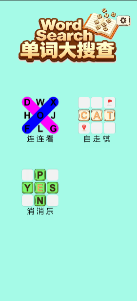
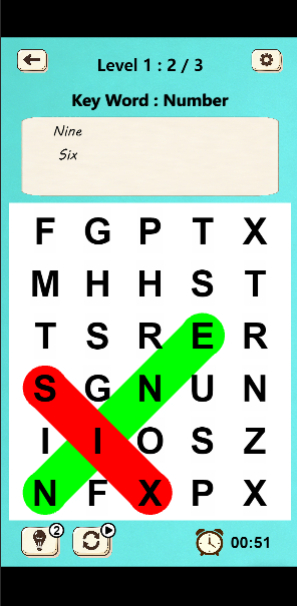
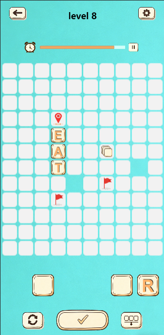
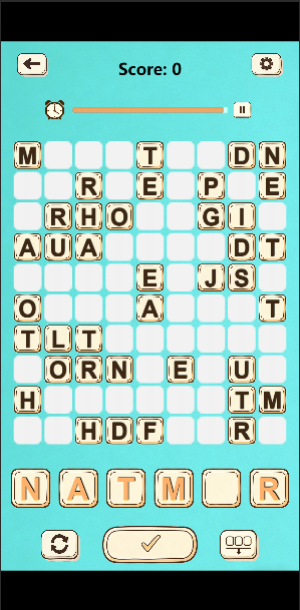

# WordSearch（单词大搜查）—— 单词消除游戏（Cocos Creator + TypeScript）

一款面向抖音小游戏平台的英文单词休闲游戏，独立完成策划、编码、测试全流程，三种玩法共享同一套抽象基类架构，全部游戏逻辑以 TypeScript 编写（51 个文件、约 6.7k 行）。已申请软件著作权（《单词大搜查游戏软件》）。

## 界面预览

| 主页 | 连连看 |
|:---:|:---:|
|  |  |

| 自走棋 | 消消乐 |
|:---:|:---:|
|  |  |

更多界面截图（难度/关卡选择、通关结算、抖音平台健康忠告页）见 [`docs/images/`](./docs/images/)。

## 玩法

| 玩法 | 目录 | 说明 |
|---|---|---|
| 连连看 | `assets/Scripts/FindLineGame/` | 在字母网格中按行/列/斜向圈出目标单词，单词按主题分类（动物、颜色、水果等），200 关 × 3 难度共 600 关 |
| 自走棋 | `assets/Scripts/ChessGame/` | 拖拽手牌中的字母块到棋盘组词，经词库校验后确认部署，10 关 × 3 难度 |
| 消消乐 | `assets/Scripts/WordPopGame/` | 消除字母块组词过关，100 关 × 3 难度共 300 关 |

核心交互统一为：从手牌区拖拽字母块 → 棋盘碰撞检测与格子状态高亮 → 确认部署 → 词库校验成词。

## 技术架构

**一套基类，三种玩法**——通过模板方法模式将跨玩法复用的流程沉到抽象基类，子类只实现差异部分：

```
BaseGameManager（抽象）      游戏流程骨架：触摸拖拽、按钮事件、暂停/恢复、关卡重置
 ├─ ChessGame/GameManager
 ├─ FindLineGame/GameManager
 └─ WordPopGame/GameManager

BaseBoardManager（抽象）     网格系统：坐标换算、碰撞检测、格子状态机
BaseHandManager（抽象）      手牌区：字母块拖拽、吸附、部署/撤销
```

几个值得一看的实现点：

- **格子五态状态机**（`BaseBoardManager`）：Blank / Hover / Pending / Resolved / Occupied，拖拽过程中由碰撞检测驱动状态流转
- **模板方法复用**（`BaseGameManager`）：三种玩法的触摸事件绑定/解绑、确认/取消/换牌按钮逻辑完全复用，子类只实现 `OnGamePage` / `ResetGame` / `DeployConfirm` 三个抽象方法
- **单例事件总线**（`EventManager`）：枚举类型化事件名 + 幂等注册（off-before-on），页面/窗口/游戏间解耦
- **词频加权随机生成**（`Dictionary`）：按字母出现频率加权随机，保证随机棋盘的可玩性；词库含释义与用例
- **动效纪律**：tween 链式编排（parallel / easing / delay），启动前 `Tween.stopAllByTarget` 防连点动画叠加

## 运行

1. 安装 [Cocos Creator **3.8.8**](https://www.cocos.com/creator-download)
2. 用 Dashboard 打开本项目根目录
3. 打开 `assets/scene.scene` 中的主场景，预览运行

面向抖音小游戏平台开发与构建（`build-templates/bytedance-mini-game`），集成平台激励视频/插屏广告接口。

## 目录结构

```
assets/
  Scripts/              全部游戏逻辑（TypeScript）
    Base*.ts            跨玩法抽象基类与全局管理器
    ChessGame/          自走棋玩法
    FindLineGame/       连连看玩法
    WordPopGame/        消消乐玩法
  resources/            词库 JSON、音频等资源
build-templates/        小游戏构建模板
settings/               项目设置
```

## License

[MIT](./LICENSE)
